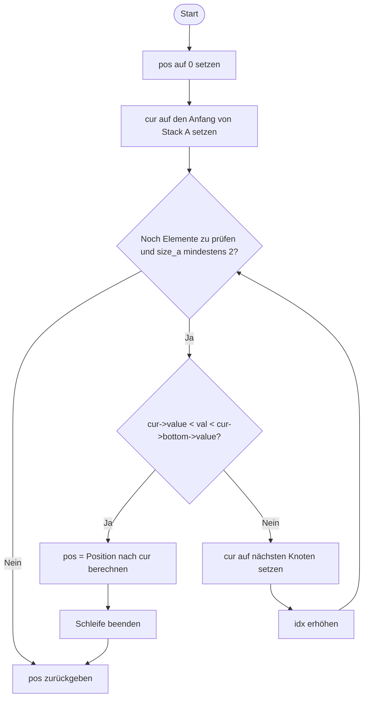

# `find_insert_pos` – was macht diese Version?

Die Funktion läuft durch Stack A und sucht ein benachbartes Wertepaar, zwischen dem `val` liegt.

```c
if (cur->value < val && val < cur->bottom->value)
```

Beispiel: Wenn Stack A so aussieht:

```text
3 → 8 → 13 → ...
```

und `val` gleich `10` ist, dann gilt:

```text
8 < 10 < 13
```

Die Funktion gibt die Position direkt nach `8` zurück.

## Schritt für Schritt

1. `pos` wird auf `0` gesetzt. Das ist gleichzeitig der Standardwert, falls kein passendes Paar gefunden wird.
2. `cur` zeigt auf den ersten Knoten von Stack A.
3. Die Schleife läuft über Stack A, solange:
   - noch nicht alle Elemente geprüft wurden und
   - Stack A mindestens zwei Elemente hat.
4. Für jedes Element wird geprüft, ob `val` zwischen `cur->value` und `cur->bottom->value` liegt.
5. Wenn ja, wird die Position nach `cur` gespeichert und die Schleife beendet.
6. Am Ende wird `pos` zurückgegeben.

## Flowchart



## Beispiel: Eine passende Stelle wird gefunden

```text
Stack A:  3 → 8 → 13 → 21
val:      10
```

Beim Paar `8 → 13` ist `8 < 10 < 13` wahr. Die Funktion gibt die Position direkt nach `8` zurück.

## Was passiert, wenn keine Stelle gefunden wird?

Weil `pos` am Anfang auf `0` gesetzt wird, gibt die Funktion `0` zurück, wenn sie kein passendes Paar findet.

Das kann zwei unterschiedliche Bedeutungen haben:

- Position `0` ist tatsächlich die richtige Einfügeposition.
- Die Funktion hat keine passende Stelle gefunden und gibt nur den Standardwert zurück.

Diese Fälle sind im Rückgabewert nicht unterscheidbar.

## Probleme und Grenzen

### 1. Der Übergang vom größten zum kleinsten Wert wird nicht behandelt

Bei kreisförmig sortiertem Stack A kann eine gültige Lücke am Übergang vom größten zum kleinsten Wert liegen.

Beispiel:

```text
Stack A:  3 → 8 → 13 → zurück zu 3
val:      20
```

Der passende Platz liegt zwischen `13` und `3`. Die Prüfung

```c
13 < 20 && 20 < 3
```

ist aber falsch. Deshalb findet die Funktion diese Stelle nicht und gibt möglicherweise `0` zurück.

Auch ein Wert kleiner als alle vorhandenen Werte, etwa `1`, gehört an diesen Übergang – wird aber ebenfalls nicht ausdrücklich erkannt.

### 2. Bei leerem oder zu kleinem Stack gibt es keine Suche

- Bei `size_a == 0` wird die Schleife nicht ausgeführt.
- Bei `size_a == 1` wird die Schleife ebenfalls nicht ausgeführt.

In beiden Fällen gibt die Funktion `0` zurück. Das kann die gewünschte Konvention sein, sollte aber bewusst festgelegt sein.

### 3. `cur` muss gültig sein

Die Schleife setzt voraus, dass `mode->head_a` gültig ist und dass `cur->bottom` für jedes geprüfte Element auf einen gültigen Knoten zeigt. Das muss die Stack-Verwaltung garantieren.

## Kurz gesagt

Diese Version findet eine Einfügestelle, wenn `val` **streng zwischen zwei aufeinanderfolgenden Werten** liegt. Sie behandelt aber nicht ausdrücklich:

- Werte außerhalb des kleinsten und größten Werts,
- den Übergang vom größten zum kleinsten Wert,
- den Unterschied zwischen „Position 0 passt“ und „keine Stelle gefunden“.

Außerdem setzt die Logik voraus, dass Stack A bereits in der erwarteten Reihenfolge sortiert ist.
