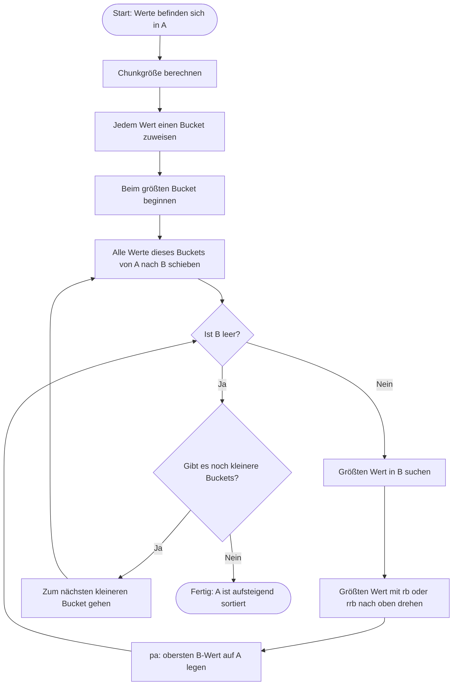
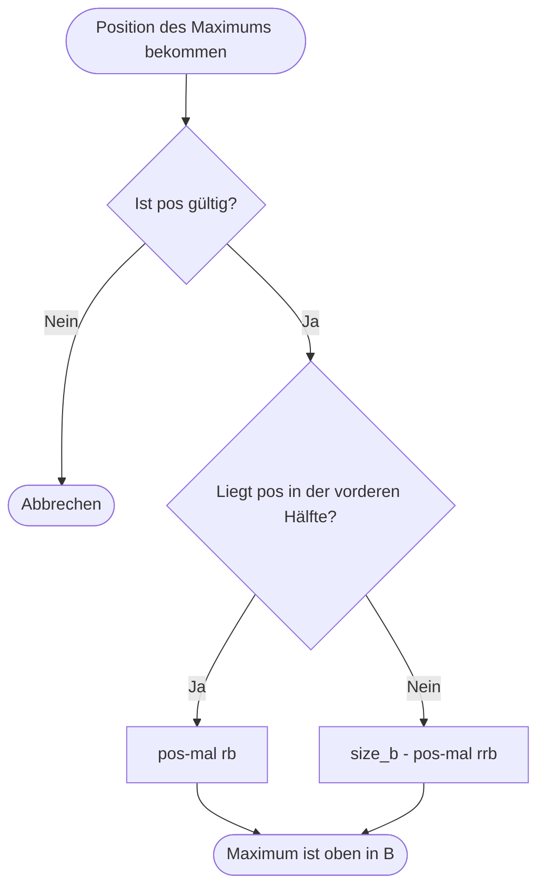

# `sort_medium` – Chunk-Sortierung einfach erklärt

## Kapitel 1: Die Grundidee

Stell dir Stack A wie einen Stapel unsortierter Karten vor. Stack B ist ein Zwischenstapel.

Die Funktion macht im Groben Folgendes:

1. Sie teilt die Werte in Gruppen, sogenannte **Buckets** oder **Chunks**.
2. Sie verschiebt die Buckets von groß nach klein von A nach B.
3. Innerhalb jedes Buckets sucht sie in B immer den größten Wert.
4. Sie bringt diesen Wert nach oben und legt ihn mit `pa` auf A.
5. Am Ende soll A von oben nach unten aufsteigend sortiert sein.

Ein Beispiel für die gewünschte Endreihenfolge:

```text
kleinster Wert
    ↓
nächstgrößerer Wert
    ↓
...
    ↓
größter Wert
```

**Wichtig:** Bei diesem Ansatz brauchst du beim Zurückholen keine Einfügeposition in A zu suchen. Du baust A durch die Reihenfolge der `pa`-Operationen auf.

---

## Kapitel 2: Überblick über den Ablauf



---

## Kapitel 3: Was bedeuten die wichtigsten Variablen?

### `size`

```c
size = mode->size_a;
```

`size` speichert die ursprüngliche Anzahl der Werte. Während der Funktion wird diese Variable nicht verändert.

### `chunk`

```c
chunk = ft_chunk_count(size);
```

Der Name `ft_chunk_count` ist etwas irreführend: Die Funktion gibt **nicht die Anzahl der Chunks** zurück, sondern die **ungefähre Größe eines Chunks**.

Bei 30 Werten:

- Die Funktion bestimmt intern `6`.
- Die Chunkgröße wird `ceil(30 / 6) = 5`.
- `chunk` ist also `5`.

Ein klarerer Name wäre zum Beispiel `chunk_size`.

### `buckets`

```c
buckets = (size + chunk - 1) / chunk;
```

Das berechnet die Anzahl der Buckets. Bei 30 Werten und einer Chunkgröße von 5:

```text
buckets = ceil(30 / 5) = 6
```

Die Buckets haben dann die IDs `0` bis `5`.

### `d`

```c
d = buckets - 1;
```

`d` ist der Bucket, der gerade verarbeitet wird. Der Code läuft abwärts:

```text
5, 4, 3, 2, 1, 0
```

---

## Kapitel 4: Wie werden die Buckets bestimmt?

Die Funktion `normalize_stack` vergleicht jeden Wert mit allen anderen Werten:

```c
if (other->value < current->value)
    rank++;
```

Damit zählt sie, wie viele Werte kleiner als der aktuelle Wert sind. Das Ergebnis ist der Rang des Werts in der sortierten Reihenfolge.

Danach wird der Rang durch die Chunkgröße geteilt:

```c
current->helper = rank / max_chunc;
```

`helper` ist damit die **Bucket-ID** des Werts. Es ist kein eindeutiger Rang mehr.

Bei 30 Werten und einer Chunkgröße von 5 gilt ungefähr:

```text
Rang  0–4   → Bucket 0
Rang  5–9   → Bucket 1
Rang 10–14  → Bucket 2
Rang 15–19  → Bucket 3
Rang 20–24  → Bucket 4
Rang 25–29  → Bucket 5
```

### Wichtig

Mehrere Werte haben denselben `helper`-Wert. Das ist beabsichtigt: `helper` sagt nur, **zu welcher Wertgruppe** ein Element gehört.

---

## Kapitel 5: Werte eines Buckets von A nach B schieben

Dieser Teil verarbeitet den aktuellen Bucket:

```c
i = 0;
while (i < size)
{
    if (mode->head_a != NULL && mode->head_a->helper == d)
        pb(mode);
    else
        ra(mode);
    i++;
}
```

Für jedes Element wird geprüft:

- Gehört der oberste A-Wert zum aktuellen Bucket? Dann kommt er mit `pb` nach B.
- Gehört er nicht dazu? Dann wird A mit `ra` weitergedreht.

So werden die Werte des aktuellen Buckets eingesammelt, während andere Werte vorerst in A bleiben.

### Warum wird `size` verwendet und nicht `mode->size_a`?

`size` ist die ursprüngliche Anzahl der Elemente. Die Schleife soll die ursprüngliche Runde durch die Elemente abarbeiten. `mode->size_a` wird durch `pb` kleiner und würde sich während der Schleife verändern.

Die `pb`- und `ra`-Operationen gehen jeweils zum nächsten noch zu prüfenden A-Element weiter: `pb` entfernt das oberste Element, `ra` schiebt es nach hinten.

---

## Kapitel 6: Den größten Wert in B finden

`find_max_pos_b` durchsucht B und merkt sich die Position des größten Werts:

```c
if (cur->value > max_value)
{
    max_value = cur->value;
    max_pos = idx;
}
```

Der Rückgabewert ist der Index dieses Maximums in B.

Beispiel:

```text
B: 14730 → 23764 → 45271 → 5178 → 39105
```

Das Maximum ist `45271`, also gibt die Funktion dessen Index zurück.

### Voraussetzung

Die Funktion wird in einer Schleife aufgerufen, solange B nicht leer ist:

```c
while (mode->head_b != NULL)
```

Dadurch ist `mode->head_b` in `find_max_pos_b` vorhanden. `mode->size_b` muss außerdem zur tatsächlichen Anzahl der Elemente in B passen.

---

## Kapitel 7: Das Maximum in B nach oben drehen

`rotate_b_to_pos` benutzt den kürzeren Weg:

- Liegt das Element in der vorderen Hälfte, dreht sie mit `rb`.
- Liegt es in der hinteren Hälfte, dreht sie mit `rrb`.



Die Funktion rotiert **B**, nicht A. Das ist hier genau das Gewünschte.

---

## Kapitel 8: Warum wird in dieser Reihenfolge `pa` benutzt?

Nach dem Rotieren steht der größte Wert von B oben:

```text
B: größter Wert → ...
```

Dann macht der Code:

```c
pa(mode);
```

`pa` legt den obersten Wert von B oben auf A.

Innerhalb eines Buckets wird also wiederholt:

1. größtes Element von B suchen,
2. dieses Element nach oben drehen,
3. mit `pa` oben auf A legen.

### Kleines Beispiel

B enthält:

```text
B: 8 → 3 → 6
```

Der Ablauf ist:

1. `8` nach A: `A = 8`
2. `6` nach A: `A = 6 → 8`
3. `3` nach A: `A = 3 → 6 → 8`

Der Bucket ist nach dem Zurückholen von oben nach unten aufsteigend.

---

## Kapitel 9: Warum werden die Buckets von groß nach klein verarbeitet?

Der äußere Ablauf startet beim größten Bucket:

```c
d = buckets - 1;
while (d >= 0)
{
    ...
    d--;
}
```

Innerhalb eines Buckets wird vom größten Wert zum kleinsten zurückgeholt. Durch `pa` wird jeder neue Wert oben auf A gelegt.

Zuerst kommen die größten Buckets. Danach kommen schrittweise kleinere Buckets oben drauf. Dadurch entsteht am Ende diese Reihenfolge:

```text
kleinster Bucket
    ↓
nächstgrößerer Bucket
    ↓
...
    ↓
größter Bucket
```

Vorausgesetzt, die Bucket-Zuordnung basiert wie hier auf dem Rang, liegen alle Werte aus einem kleineren Bucket unter den Werten aus einem größeren Bucket.

---

## Kapitel 10: Der zentrale Unterschied zu `find_insert_pos`

Bei der früheren Variante wurde versucht, für jeden neuen Wert eine passende Lücke in A zu finden. Das funktioniert nur, wenn A bereits kreisförmig aufsteigend sortiert ist.

Der aktuelle Chunk-Ablauf macht etwas anderes:

- Er sucht nicht nach einer Lücke in A.
- Er holt aus B gezielt den größten Wert.
- Die Reihenfolge der Buckets und der Maxima baut A von selbst auf.

Deshalb brauchst du in diesem Ablauf nicht:

```c
find_insert_pos(...)
rotate_to_pos(...)
```

Stattdessen verwendest du:

```c
rotate_b_to_pos(mode, find_max_pos_b(mode));
pa(mode);
```

---

## Kapitel 11: Gesamtfunktion, auf die wesentlichen Schritte reduziert

```c
void sort_medium(t_mode *mode)
{
    int chunk_size;
    int buckets;
    int original_size;
    int d;
    int i;

    original_size = mode->size_a;
    if (original_size <= 1)
        return;

    chunk_size = ft_chunk_count(original_size);
    buckets = (original_size + chunk_size - 1) / chunk_size;

    normalize_stack(mode->head_a, original_size, chunk_size);

    d = buckets - 1;
    while (d >= 0)
    {
        i = 0;
        while (i < original_size)
        {
            if (mode->head_a != NULL && mode->head_a->helper == d)
                pb(mode);
            else
                ra(mode);
            i++;
        }

        while (mode->head_b != NULL)
        {
            rotate_b_to_pos(mode, find_max_pos_b(mode));
            pa(mode);
        }

        d--;
    }
}
```

Das ist eine Übersicht der Strategie; sie setzt voraus, dass die Funktionen `pb`, `pa`, `ra`, `rb`, `rrb`, `normalize_stack`, `find_max_pos_b` und `rotate_b_to_pos` korrekt arbeiten.

---

## Kapitel 12: Was du beim Testen prüfen solltest

### Nach `normalize_stack`

Jeder Wert sollte einen `helper`-Wert zwischen `0` und `buckets - 1` haben.

### Nach dem Verteilen eines Buckets

- Werte mit `helper == d` sollten in B sein.
- Die übrigen Werte sollten in A sein.
- `size_a + size_b` sollte weiterhin der ursprünglichen Anzahl entsprechen.

### Beim Zurückholen

Vor jedem `pa` sollte das Maximum von B oben stehen.

### Am Ende

A sollte von oben nach unten aufsteigend sein:

```text
kleinster → ... → größter
```

B sollte leer sein.

---

## Kapitel 13: Zwei Hinweise zu deinem aktuellen Debug-Code

### Der erste Debug-Ausdruck steht vor `normalize_stack`

Du gibst hier aus:

```c
ft_printf("[DBG] nach normalize:\n");
print_stack(mode);

normalize_stack(mode->head_a, size, chunk);
```

Die Ausgabe kommt **vor** der Normalisierung. Die Beschriftung sollte zum Beispiel `[DBG] vor normalize` heißen oder die Ausgabe sollte hinter `normalize_stack` verschoben werden.

### Die Chunkgröße-Funktion hat einen missverständlichen Namen

`ft_chunk_count` liefert die Größe eines Chunks. Ein Name wie `ft_chunk_size` wäre verständlicher. Das ändert das Verhalten nicht, erleichtert aber das Lesen.

---

## Kurzfassung

- `normalize_stack` ordnet jedem Wert einen Bucket zu.
- Die Buckets werden von hoher ID zu niedriger ID verarbeitet.
- Werte des aktuellen Buckets wandern von A nach B.
- In B wird jeweils das Maximum gesucht.
- B wird so gedreht, dass dieses Maximum oben liegt.
- `pa` legt es auf A.
- Dieser Ablauf braucht keine Einfügeposition in A.
- Am Ende soll A von oben nach unten aufsteigend und B leer sein.
````*
