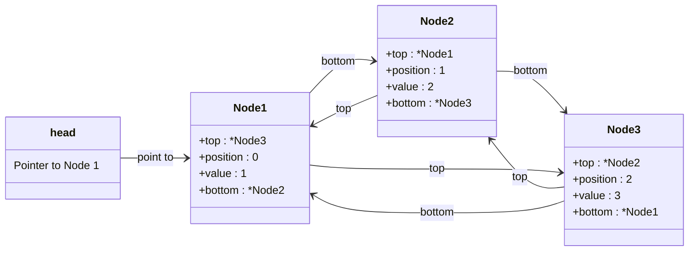
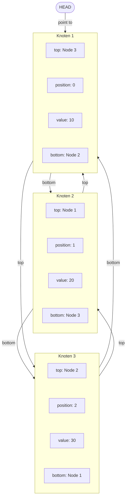

*This project has been created as part of the 42 curriculum by twalter, rulrich.*

# Description

## Algorithm Explanation & Justification

### List

# Instuctions

To compile the library use the provided makefile and the command

	make 

This command compile the whole library and create the libftprintf.a file.
Same as 

	make all

and

	make push_swap

To clean the folder and delete the created .o files use

	make clean

To clean also the created libftprintf.a use

	make fclean

To clean and recreate with one command use

	make re

# Resources

## AI use
With the help of AI, I discussed basic C topics and topics that my fellow peers couldn't answer or that were unclear to all of us.

Some unit tests include suggestions from the AI "Google Gemini".

Some translations from german into english are supported by AI translation.

## Used Resources:
- Peers :)
- Stackoverflow
- Gemini

## Files in the project folder
