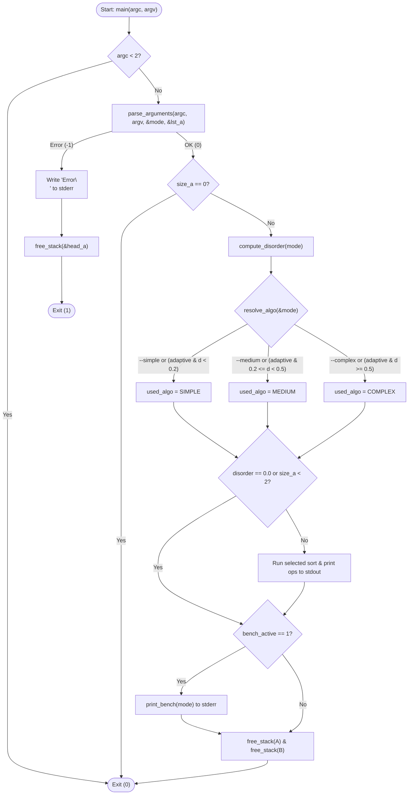
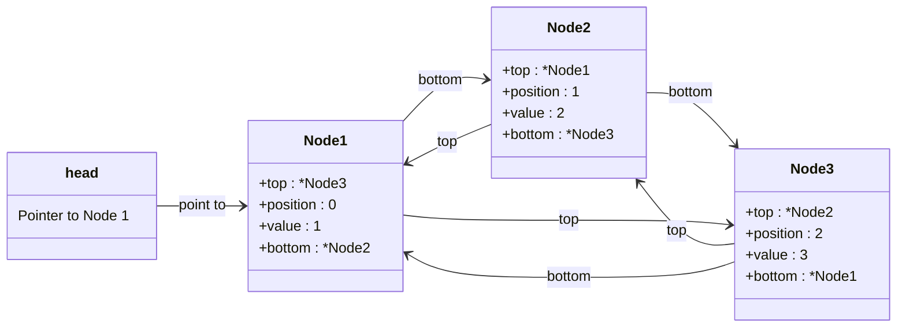

*This project has been created as part of the 42 curriculum by twalter, rulrich.*

# Description

`push_swap` is a sorting algorithm project from the 42 curriculum. The goal is to sort a list of unique integers in ascending order on **stack A**, using an auxiliary **stack B** and a restricted set of stack operations (`sa`, `sb`, `ss`, `pa`, `pb`, `ra`, `rb`, `rr`, `rra`, `rrb`, `rrr`), while minimizing the total number of moves.

This implementation supports four sorting strategies:
- **Simple** ($O(n^2)$)
- **Medium** ($O(n\sqrt{n})$)
- **Complex** ($O(n \log n)$)
- **Adaptive** *(default)*: automatically chooses between Simple, Medium, and Complex based on the initial disorder of stack A.

An optional `--bench` flag outputs the computed disorder, selected strategy, complexity class, total operations, and per-operation counts to `stderr`.



## Algorithm Explanation & Justification

### List

Both stacks (`A` and `B`) are implemented as **circular doubly-linked lists** (`t_node`). Each node stores:
- `value`: the integer value
- `position`: the 0-based index from the top of the stack (`0` = head)
- `top`: pointer to the previous node (the head's `top` points to the last node)
- `bottom`: pointer to the next node (the last node's `bottom` points to the head)

**Why a circular doubly-linked list?**
- **O(1) rotations:** `ra`/`rb` (`head = head->bottom`) and `rra`/`rrb` (`head = head->top`) only move the head pointer without traversing the list to find the tail.
- **O(1) push and swap:** `pa`/`pb` and `sa`/`sb` only relink a fixed number of pointers at the head, avoiding array shifts.




### Adaptive Strategy

When `--adaptive` (or no strategy flag) is used, the program computes the initial `disorder` ratio ($0.0$ = already sorted, $1.0$ = completely reversed) and selects the sorting strategy accordingly:
- `disorder < 0.2` → **Simple** ($O(n^2)$)
- `0.2 <= disorder < 0.5` → **Medium** ($O(n\sqrt{n})$)
- `disorder >= 0.5` → **Complex** ($O(n \log n)$)

# Instructions

## Build

To compile the programm use the provided makefile and the command

	make 

This command compiles the program and create the push_swap binary.
Same as 

	make all

and

	make push_swap

To clean the folder and delete the created .o files use

	make clean

To clean also the created binary and .a files use

	make fclean

To clean and recreate with one command use

	make re

## Usage

Run `push_swap` with a list of integers (as separate arguments or a single quoted string):

```bash
./push_swap 2 1 3 6 5 8
./push_swap "2 1 3 6 5 8"
```

### Strategy & Benchmark Flags

	• --adaptive (default): Selects the strategy automatically based on the initial disorder.
	• --simple: Forces the O(n²) algorithm.
	• --medium: Forces the O(n√n) algorithm.
	• --complex: Forces the O(n log n) algorithm.
	• --bench: Prints disorder, selected strategy, total operation count, and individual operation counts to stderr.

```bash
./push_swap --medium 4 67 3 87 23
./push_swap --bench 4 67 3 87 23
./push_swap --bench --complex "4 67 3 87 23"
```

# Resources

## AI use
All code and architectural decisions were written by us. AI (Google Gemini) was used strictly in an advisory, read-only role, never to generate the complete solution, and every suggestion was critically reviewed, tested, and discussed between us so that we fully understand and take responsibility for every line of code.

Specifically, AI assisted with:
- Explaining C concepts and answering questions that remained unclear after discussing them with peers
- Suggesting ideas for unit tests and edge-case testing
- Translating and proofreading documentation (Doxygen comments and README) from German into English
- Assist with the mermaid diagram in the README.md

## Used Resources:
- Peers :)
- Stackoverflow
- Gemini

## Files in the project folder
- `push_swap.c`: Program entry point, error handling, and cleanup.
- `push_swap.h`: Data structures (`t_node`, `t_mode`, `t_algo`) and prototypes.
- `arguments.c`: CLI flag and integer argument parsing.
- `node_functions.c`: Node creation, duplicate check, disorder calculation, and list healing.
- `stack_operations_1.c` – `stack_operations_4.c`: Stack operations (`sa`, `sb`, `ss`, `ra`, `rb`, `rr`,
`rra`, `rrb`, `rrr`, `pa`, `pb`).
- `sort_selector.c`: Adaptive strategy resolution and sort dispatching.
- `bench.c`: Benchmark output formatting to `stderr`.
- `Makefile`: Build rules for `push_swap` and `ft_printf`.
- `ft_printf/`: Custom `ft_printf` and `libft` libraries.
