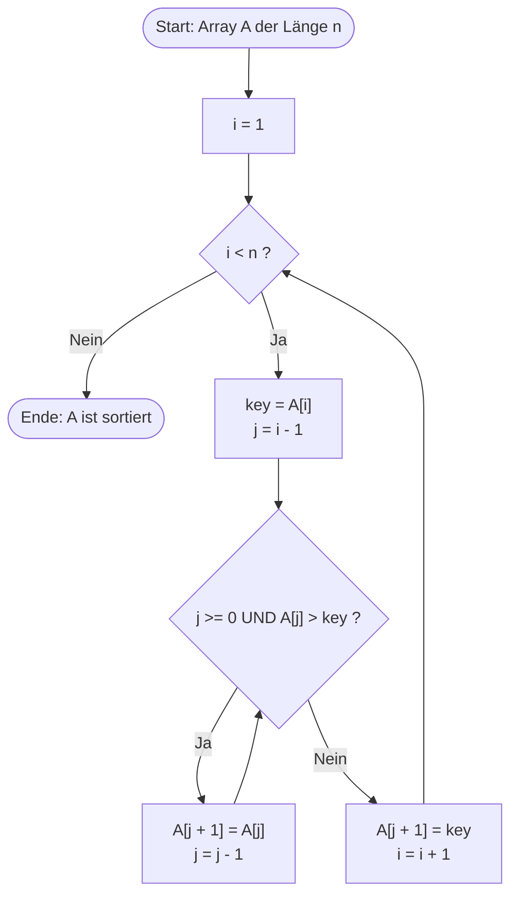
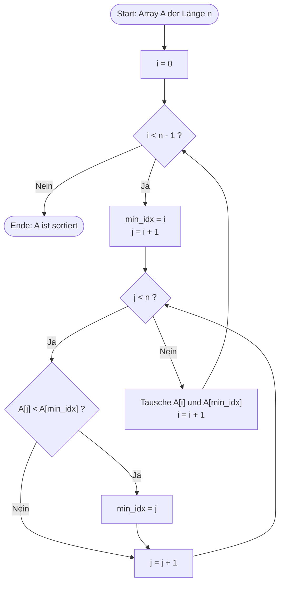
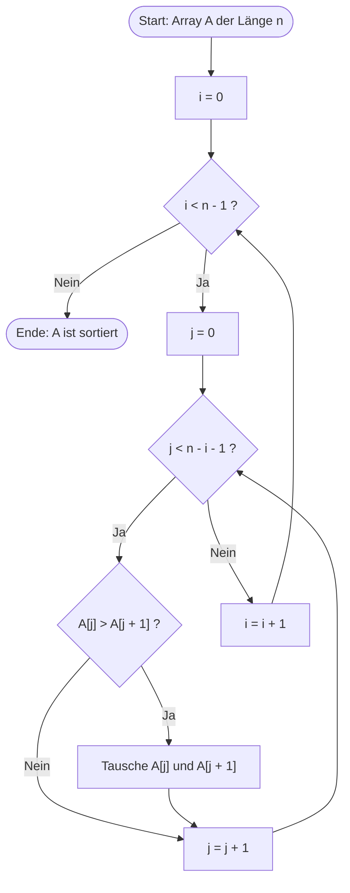
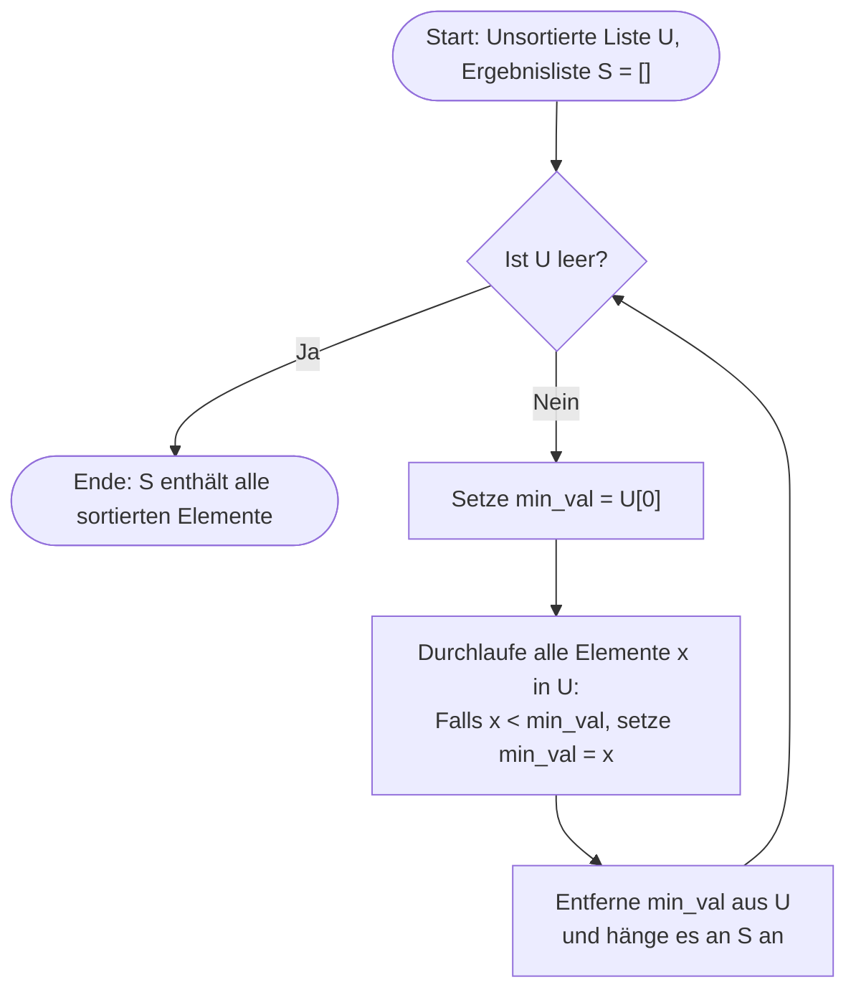

# Ablaufdiagramme (Flowcharts) für einfache $O(n^2)$-Algorithmen

Dieses Dokument enthält die visuellen Ablaufdiagramme (als **Mermaid-Flowcharts**) sowie die logische Schrittfolge für die vier geforderten Basis-Strategien aus der Komplexitätsklasse $O(n^2)$:

1. **Insertion Sort Adaptation** (Einfügesortieren)
2. **Selection Sort Adaptation** (Auswahlsortieren)
3. **Bubble Sort Adaptation** (Blasensortieren)
4. **Simple Min/Max Extraction Methods** (Einfache Min/Max-Extraktionsmethoden)

---

## 1. Insertion Sort Adaptation (Einfügesortieren)

**Grundidee:** Das Array $A$ der Länge $n$ wird in einen bereits sortierten linken Teil und einen unsortierten rechten Teil unterteilt. In jedem Schritt wird das erste Element des unsortierten Teils (`key`) an die richtige Position im sortierten Teil verschoben.

* **Best Case:** $O(n)$ (bereits sortiert)
* **Worst / Average Case:** $O(n^2)$

---

## 2. Selection Sort Adaptation (Auswahlsortieren)

**Grundidee:** Das Array $A$ wird schrittweise von links nach rechts aufgebaut. In jedem Durchlauf $i$ wird im verbleibenden unsortierten Teilbereich $[i, n-1]$ das kleinste Element gesucht (`min_idx`) und mit dem Element an Position $i$ getauscht.

* **Best / Average / Worst Case:** Immer $O(n^2)$ Vergleiche, maximal $O(n)$ Vertauschungen.

---

## 3. Bubble Sort Adaptation (Blasensortieren)

**Grundidee:** Benachbarte Elemente $A[j]$ und $A[j+1]$ werden paarweise verglichen und bei falscher Reihenfolge vertauscht. Dadurch wandert das jeweils größte Element wie eine Blase an das Ende des unsortierten Bereichs.

* **Worst / Average Case:** $O(n^2)$
* **Hinweis zur Optimierung:** Durch ein `swapped`-Flag kann der Algorithmus vorzeitig abbrechen, falls in einem Durchlauf kein Tausch stattgefunden hat (Best Case $O(n)$).

---

## 4. Simple Min/Max Extraction Methods (Min/Max-Extraktion)

**Grundidee:** Aus einer unsortierten Eingabemenge $U$ wird in jedem Schritt durch einen linearen Suchlauf ($O(n)$) das globale Minimum (oder Maximum, bzw. beides gleichzeitig bei beidseitiger Extraktion) ermittelt, aus $U$ entfernt und an die Ergebnisstruktur $S$ angefügt. Da dies $n$-mal wiederholt wird, ergibt sich eine Gesamtlaufzeit von $O(n^2)$.

* **Variante (Gleichzeitige Min- & Max-Extraktion):** Pro Durchlauf werden sowohl das Minimum als auch das Maximum gesucht und an den linken bzw. rechten Rand der Zielstruktur gesetzt. Die Anzahl der Durchläufe halbiert sich auf $\lceil n/2 \rceil$, die asymptotische Laufzeit bleibt jedoch $O(n^2)$.